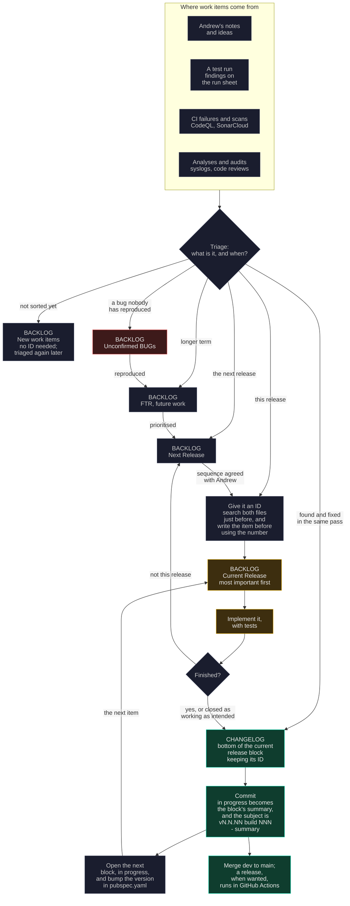

# Plan: CHANGE-PROCESS.md (ID-635)

The design and the reasoning for ID-635. Status lives in the work item, never here.

## Why

The rules for work items live in three places: CHANGELOG.md's header and the top of its section 1.3, BACKLOG.md's prefix codes, IDs and triage prompt, and ARCHITECTURE.md appendix 14. They drift apart, and they bury the work items. Andrew's outcome: CHANGELOG.md and BACKLOG.md hold work items only, and a single CHANGE-PROCESS.md holds the process. Each work item file keeps one line telling the reader, human or agent, to always read and follow it.

## Decisions (Andrew, 2026-11-20)

- The file is CHANGE-PROCESS.md, in the repository root.
- The prefix table moves with the rest. BACKLOG's two backlog-only prefixes (OPS, FTR) move into the same table.
- ARCHITECTURE.md appendix 14 becomes a pointer to the new file. The heading and anchor stay so the contents list stays tidy.
- Both work item files open with the same pointer line.

- CHANGELOG.md holds only what was done. Sections 1.1 Pending to do and 1.2 WIP move into BACKLOG.md as two named sections, "Next Release" (today's 1.1) and "Current Release" (today's 1.2). One item, not two: Andrew's decision, 2026-11-20, over the plan's first recommendation to split it.
- The in-progress release block (`<date> vN.N.NN build NNN - in progress`) stays in CHANGELOG's history, because items land there as they are finished.

## Part B: sections 1.1 and 1.2 move to BACKLOG

The rule becomes: done is in CHANGELOG, not done is in BACKLOG. An item moves once, when it closes, and the step of moving an item into WIP goes. What changes:

- BACKLOG.md gains "Current Release" and "Next Release" above its existing sections, in that order, each keeping its items in descending importance, which is the intended build order. CHANGELOG.md loses the 1.1 and 1.2 headings, its contents list, the sequencing text and the `1.x` references follow, and its "Implemented - chronological change history" section is renumbered (the title stays word for word, since the release parser matches the title).
- BACKLOG's layout becomes: 1 Current Release, 2 Next Release, 3 Backlog (3.1 Unconfirmed BUGs, then 3.2 FTR - future implementation), 4 New work items. The "DOC - documentation updates" and "Codebase cleanup" sections are deleted, Andrew's decision 2026-11-20: both are empty and won't be used that way again. DOC stays a valid item prefix, and a documentation item goes in whichever section matches its timing. Unconfirmed BUGs comes before FTR so unreproduced bugs are read before future work. Anything that cites a BACKLOG section number ("BACKLOG 1.1.3", `1.1 wants` in `scripts/capture-baseline.sh`) is found by the sweep and updated.
- `changelog_ids_test.dart` and `changelog_structure_test.dart` look for 1.1 and 1.2 by heading in CHANGELOG and expect to find them. They are changed to read those two sections in BACKLOG.md as well as the release blocks in CHANGELOG.md, with their ID and fragment checks unchanged. Their own tests of the check keep running.
- The process text is rewritten: the triage prompt, the "move agreed items to WIP" step (it becomes "move agreed items to Current Release"), the WIP count statement, and the commit steps that mention 1.1 or 1.2.
- `tool/release_notes.dart` reads only the history under the "Implemented - chronological change history" heading, so it isn't affected, but the heading's number may change and it matches on the title, not the number.
- Work is done in two parts inside the one item, each ending with `flutter test` passing and the release notes output compared: Part A (the process text moves out), then Part B (the sections move). That keeps a failure attributable to one move.

## What moves

From CHANGELOG.md:

- The prefix codes table.
- "Work items: less is better", with its `DoD:`, `Plan:` and `Now:` rules.
- The rule that a privacy or security item isn't done until its check has been seen to fail.
- Unique IDs, the exempt lines (release result, audit line), the format and the example.
- The description of 1.1, 1.2 and 1.3 and their sequencing.
- The numbered steps at the top of section 1.3 (before the commit, SonarCloud, and opening the next block).

From BACKLOG.md: the prefix codes, IDs, and the triage prompt.

From ARCHITECTURE.md appendix 14: the process diagram and its text move into CHANGE-PROCESS.md, rather than being dropped, and the diagram is redrawn for the new layout (see "The flow chart" below). The appendix keeps a sentence and a link. Appendix 15 (GitHub Actions workflows) is a different subject and stays.

### The flow chart

The diagram in appendix 14 is wrong for the new layout in four places, so it is redrawn, not just moved:

- Its CHANGELOG 1.1 "Pending to do" node becomes BACKLOG "Next Release", and its CHANGELOG 1.2 "WIP" node becomes BACKLOG "Current Release". Its "BACKLOG 1.1 - 1.3" and "BACKLOG 1.1.3" node labels follow the new layout: the longer-term node reads "BACKLOG FTR" and the unconfirmed bug node reads "BACKLOG Unconfirmed BUGs".
- The audit-line node ("Every item added to or removed from WIP gets an audit line") is removed. Audit lines are no longer written (CHANGELOG, 2026-11-11), so the diagram has been out of date since.
- A work item now crosses from BACKLOG to CHANGELOG exactly once, when it closes, so the one arrow into the release block is the only crossing.
- The diagram's text says the rules live in the headers of BACKLOG.md and CHANGELOG.md. It now says they live in CHANGE-PROCESS.md.

The redrawn diagram, to be checked against the final section names before it goes in:

The caption under the diagram changes to "A work item's route from where it was noticed, through BACKLOG to CHANGELOG, to a commit and a release."

### Step 4 and the rule that exists twice

Step 4 of the commit steps ("Straight after the commit", open the next release block and bump `pubspec.yaml`, both halves, and never commit them on their own) was read in full on 2026-11-20. It is one self-contained rule with no links and nothing that tests read, so it moves as it is, including its note that a fix commit after a pushed PR writes the next block after the commit and never in it (broken 2026-11-16, build 582's commit carried build 583's header).

CLAUDE.md's last convention bullet ("After every commit, and after every release ... the next CHANGELOG release block ... must be open and `pubspec.yaml`'s `version:` must match it") is the same rule in different words, and it adds the release case (a dev-to-main merge and its tag) and a check at the start of any work. Two wordings will drift. The merged wording in CHANGE-PROCESS.md keeps the release case and the start-of-work check, and CLAUDE.md's bullet is cut to one sentence and a link. The same applies to any other CLAUDE.md bullet that restates a moved step: the Sonar bullet ("Before every commit that changes Dart code ...") and the "Every commit is a build and follows the steps at the top of CHANGELOG.md" bullet. Each keeps what is specific to Andrew's working agreement and links to CHANGE-PROCESS.md for the steps.

## What stays

Two lists, and the second answers the first: some things stay in each file, and the work items that are not yet done leave CHANGELOG.

CHANGELOG.md keeps:

- The title, the pointer line, and the "do not alter the structure" line, reworded to name what depends on it (the history heading's title and the release block header format).
- A contents list with the history heading only.
- The "Implemented - chronological change history" section, its title word for word, and every release block in it, including the in-progress one. The section's number changes (1.3 becomes 1.1) once the two sections above it leave.

CHANGELOG.md loses:

- The 1.1 "Pending to do" and 1.2 "WIP" headings, with every work item under them. Those items move to BACKLOG.md (Part B), in the same order.
- The prefix codes, the work item rules and the commit steps (Part A).

BACKLOG.md keeps:

- The title, the contents list, the pointer line, the Backlog section with Unconfirmed BUGs (3.1) and FTR (3.2), and `New work items` with a one-line pointer to the triage steps. The empty DOC and Codebase cleanup sections are deleted.

BACKLOG.md gains:

- "Current Release" and "Next Release", holding the work items that were in CHANGELOG 1.2 and 1.1, in their existing order, as sections 1 and 2. The remaining sections are renumbered after them (see Part B).
- The pointer line, and no prefix codes, ID rules or triage prompt (Part A).

## What reads these files (checked 2026-11-20)

| Reader | Reads | Consequence |
| --- | --- | --- |
| `tool/release_notes.dart`, run by `release.yml` | Everything after the heading containing "Implemented - chronological change history", from the first `YYYY-MM-DD vN.N.NN` line. Text before that line is ignored. | The history heading's title and the block headers must not change; the heading's number may. The steps before the first block can leave safely. |
| `changelog_ids_test.dart` | Top-level bullets in 1.1, 1.2 and blocks from build 535 on | Part A: not affected. Part B: changed to read Current Release and Next Release in BACKLOG.md, and the release blocks in CHANGELOG.md. |
| `changelog_structure_test.dart` | Stray lines in 1.1, 1.2 and blocks from build 535 on; 1.3 skipped; it expects to find sections 1.1 and 1.2 | Part A: not affected. Part B: changed the same way, and its "sections are found" check looks for the two BACKLOG sections. Prose before a section's first bullet stays allowed. |
| `ci_config_test.dart`, line 207 | CHANGELOG.md contains the step-3 text about THIRD-PARTY-NOTICES.md | Fails unless repointed at CHANGE-PROCESS.md in the same change. |
| `markdown_links_test.dart` | Links and anchors in the Markdown files | The new file's links must resolve, and the ARCHITECTURE contents list must match the appendix. |
| `release_notes_test.dart`, `capture-baseline.sh`, `no_lan_identifiers_test.dart` | A fixture, a comment, a comment | Not affected. |

## Method

1. Read the whole of each source section. Step 4, the long line, has been read (see above), so every step is now known.
2. Write CHANGE-PROCESS.md: one rule in one place, a contents list, no hard-wrapping, in Andrew's voice (`.claude/testing/voice-guide.md`). Where ARCHITECTURE's appendix says the same thing as CHANGELOG, keep one wording, the newer one.
3. Cut the same text from the three source files with the Edit tool, never a scripted edit (CONTEXT.md section 1, and the 2026-11-17 split bullet). Read each file back afterwards.
4. Add the identical pointer line to the top of CHANGELOG.md and BACKLOG.md.
5. Repoint `ci_config_test.dart` line 207. Add a test that fails if either work item file loses its pointer line, and one that fails if a rule heading from CHANGE-PROCESS.md reappears in either file.
6. Sweep for references and update them: CLAUDE.md ("the steps at the top of CHANGELOG.md", "the header above section 1"), CONTEXT.md, README and TESTING.md wording, the plan files that name those sections, and the ARCHITECTURE.md contents list.
7. Update the testing figures in README section 2 for the tests added (CLAUDE.md rule).
8. Run `flutter test`, then run `tool/release_notes.dart` against the current CHANGELOG.md and compare its output with the output before the move. They must match.

## Risks

- A rule is lost in the move. Counter: list every rule heading and numbered step before the cut, and tick each off in the new file.
- The release workflow's notes change. Counter: the before and after comparison in step 8.
- Agents stop following rules they no longer see. Counter: the pointer line, the safeguard test, and CLAUDE.md's reading list naming the new file first.
- Old links to CHANGELOG sections that moved, in plan files or comments. Counter: the markdown links test, and the sweep in step 6.
