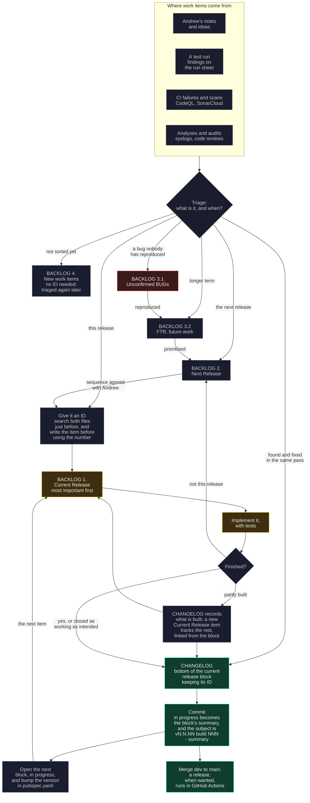

# CHANGE-PROCESS.md

How work items are written, sequenced, moved and committed. [BACKLOG.md](BACKLOG.md) and [CHANGELOG.md](CHANGELOG.md) hold work items and nothing else; every rule about them lives here. Both open with a line telling the reader to read this file first, and `test/unit/change_process_test.dart` fails if either loses it.

- [1. Where a work item lives](#1-where-a-work-item-lives)
- [2. Prefix codes](#2-prefix-codes)
- [3. Writing a work item](#3-writing-a-work-item)
- [4. Unique IDs](#4-unique-ids)
- [5. Triage](#5-triage)
- [6. Moving a work item](#6-moving-a-work-item)
- [7. Release blocks](#7-release-blocks)
- [8. Committing](#8-committing)
- [9. The route of a work item](#9-the-route-of-a-work-item)

---

## 1. Where a work item lives

A work item is either not done or done. BACKLOG.md holds what is not done. CHANGELOG.md holds what is done.

| Where | What it holds |
| --- | --- |
| BACKLOG.md, 1. Current Release - planned work | The work planned for the release being built, in the order it is to be done, and not yet built |
| BACKLOG.md, 2. Next Release - planned work | The work planned for the release after, not yet built, which may not have been sequenced yet |
| BACKLOG.md, 3.1 Unconfirmed BUGs | A bug nobody has reproduced. Unverified bugs live here, never in CHANGELOG.md |
| BACKLOG.md, 3.2 FTR - future implementation | Longer term work, not yet scheduled to a release |
| BACKLOG.md, 4. New work items | Items Andrew has just noted, unsequenced and often without an ID, until they are triaged |
| CHANGELOG.md, 1. Implemented | Every release and the work items completed in it |

Current Release and Next Release are sequenced in descending relative importance, which is the intended implementation sequence. Work items in Next Release may not have been sequenced: review and agree the sequence before moving any item to Current Release. Current Release can be divided by `####` headings that mark where a commit is planned ("Commit 1 - build 589: ..."), each followed by the items that go into it, in order; a heading with no items under it is a commit whose items are already built. A group of items in Next Release that depend on something can open with an introduction, for example `Work items for the **next** release (requires Merlin to be swapped out for STOCK firmware):`. That is the only prose allowed between bullets.

Each release block in CHANGELOG.md lists its completed work items in chronological implementation sequence, oldest first, so the most recently completed item is at the bottom of its block.

The outcome Andrew wants: anything that has been built is in CHANGELOG.md, and anything that has yet to be built is in BACKLOG.md. An item is in BACKLOG.md only while nothing for it has been built. Two rules make that so, Andrew's of 2026-11-21 (ID-644 was built into build 588 while its item sat in Next Release, so the block that shipped it had no record of it):

1. **Anything built is listed, at once.** As soon as any source code or markdown that relates to a work item is altered, that item moves to CHANGELOG.md, to "1. Implemented - chronological change history", under the current release block, whether or not the item is finished. Source code means everything under `lib/`, `test/`, `tool/`, `scripts/`, `android/`, `ios/` and `.github/`, and the files at the root that build the app (`pubspec.yaml`, `pubspec.lock`). Markdown means every `.md` file except BACKLOG.md and CHANGELOG.md, which hold the work items and are not themselves the work, and except the plan files under `.claude/plans/`. Writing or editing a plan creates no work item and moves none: the item a plan relates to names the plan file in its description, in its `Plan:` line (section 3), and if a plan is written for an item that doesn't name it yet, the name is added there. Run sheets and every other `.md` file count. The move is made with the first edit, in the same turn, not at the commit.
2. **A partly implemented item is split, and the remainder is tracked.** The item moves to that block with what was built, and a new item in BACKLOG.md's Current Release (a new ID, with a `Now:` line) tracks the rest. The block's entry links to the new item by ID, in its closing line: `Partly done <date>: <what is built and the evidence>. Remainder: ID-NNN.` The new item's own first line says which item it continues.

A change that relates to no item gets one first (section 4), since every change is a work item.

CHANGELOG.md's structure must not change: GitHub Actions read it. The release workflow reads the heading whose title is "Implemented - chronological change history" and every release block header below it (section 7). Text above the first release block is ignored by it.

## 2. Prefix codes

Work items use these three-letter prefixes.

| Prefix | Meaning |
| :----: | --- |
| ADD | New feature or capability added |
| ARC | Architecture, design or structure notes |
| BLD | Build process or build scripts |
| BUG | Known bug or defect |
| CFG | Configuration change |
| CHG | General change to existing behaviour |
| DEC | Design decision recorded |
| DELETE | Removal of a file, feature, or item |
| DOC | Documentation |
| FIX | Bug fix |
| FTR | Future feature, not yet scheduled to a release (BACKLOG.md only) |
| GUI | User interface change, may also appear under UI |
| INF | Informational note, points elsewhere for detail |
| MOD | Code modification or optimisation |
| NOTE | General note |
| OPS | Operational issue: hosting, an external service, infrastructure (BACKLOG.md only) |
| REL | Release process or release readiness item |
| SEC | Security related change |
| TST | Test added or updated |
| UI | User interface, element or copy level, may also appear under GUI |

## 3. Writing a work item

Work items: less is better. A work item says what is to be done, at a high level, in as few lines as it can: often its first line alone. It is not a running status, and it doesn't grow. Add a line only when it earns its place, and only these:

- `DoD:` the definition of done, when the first line doesn't make it plain. For an item that changes what the app does to the router, it names the item's two log lines, the app log's and the router's (CONTEXT.md section 1, ID-617).
- `Plan:` a link to its plan file in `.claude/plans/`, which holds the design, the decisions, the reasoning and a dated log of runs and evidence.
- `Now:` where it stands, in one line, replaced when it changes, never added to. Anything still to do is written here, never only in the plan.

Every line of a work item, the first line and each `DoD:`, `Plan:`, `Now:` and `Closed` line, is at most two sentences: a summary a reader understands, not a record. The detail goes to the plan file, moved there word for word and never deleted. `test/unit/work_item_length_test.dart` reads CHANGELOG.md's newest block and BACKLOG.md's Current Release and fails on a longer line, on a line that is not one of those four, and on bold (Andrew, 2026-11-22, after about 25 items grew into paragraphs).

No bold inside work items. When an item closes, it moves to its release block with one line added: `Closed <date>: <the evidence>.` An item that is only partly built goes to the block the same way, with `Partly done <date>: <what is built and the evidence>. Remainder: ID-NNN.` instead (section 1). Release blocks before build 535 keep their older, longer form.

A privacy or security item is not done until its check has been seen to fail. Before a SEC item, or any item that makes or changes a claim about protection, moves out of Current Release, a check that breaks the protected path must exist, and it must have been run and seen to fail with the protection broken and pass with it restored. The check goes in `scripts/check-claims.sh` wherever it can run on the router. A test that only checks command text doesn't count. This rule was added on 2026-09-30, after the watchdog's encrypted lookups (ID-076) turned out never to have worked.

## 4. Unique IDs

Every work item gets an ID, wherever it lives. Two exceptions: an item parked in BACKLOG.md's New work items stays ID-free until it is triaged (there may be IDs there if Andrew or Claude moved items back), and two kinds of line in CHANGELOG.md record what happened rather than work and take no ID: a release result, `REL: vN.N.NN (NNN) passed <date> (run N): ...`, and an old audit line, `CHG: WIP|1.1|BACKLOG ...`, which older blocks have and which is no longer written (a change to Current Release is reported in the reply, not in a file; Andrew, 2026-11-11). Anything else is a work item and gets an ID, however small, including work found and done in the same pass. Unprefixed sub-bullets stay ID-free. `test/unit/changelog_ids_test.dart` fails any other line without one, in Current Release, Next Release and the release blocks from build 553 on; builds 541 to 552 keep some ID-free items from before the test, and v0.8.77 build 447 and every earlier release keep their original ID-free form.

IDs are one number line across both files, so an ID always points to exactly one item no matter which file it lives in. Once given, an ID does not change, even when the item moves section. Closed items keep their number.

Format: `ID-NNN XXX:`, where `XXX` is the item's prefix code, placed at the start of the bullet before the prefix.

Example:

- ID-014 FIX: the watchdog passes a tunnel that handshakes but cannot resolve names...

To assign a new ID, search both CHANGELOG.md and BACKLOG.md for the highest existing `ID-NNN` and use the next number. No separate counter or log to maintain, and nothing already in either file needs to be touched or renumbered.

Search again immediately before each new ID, even within a batch, and write the item into the file before using its number anywhere else.

## 5. Triage

When asked to triage BACKLOG's new work items, work through it in this order:

1. Check for duplicates. For each item in New work items, check whether it duplicates or overlaps with anything in Current Release, Next Release, the rest of BACKLOG.md, or a release block in CHANGELOG.md. Flag any overlap found rather than silently merging or dropping it.
2. Add a unique ID to any item that does not already have one (section 4).
3. Sequence into batches. Group the work items into logical implementation batches, following the same descending-importance rule as section 1. Batches should reflect what makes sense to build and test together, not just priority order.
4. Flag anything unclear. Before moving anything, list any item where the requirement, scope, or expected behaviour needs clarification from Andrew. Wait for answers before proceeding on those specific items; the rest of the triage can continue.
5. Move agreed items to Current Release. Once Andrew confirms the batching, move the agreed work items into BACKLOG.md's Current Release, or Next Release for the one after. Take into account what is already there, resequencing existing items if the combined set changes the intended build order. Remove moved items from New work items.
6. Do not start implementing. Stop after the move and wait for Andrew to separately say to begin implementation.
7. Reference work items in conversation. When discussing work items, include the ID number and a very brief sentence that describes that item at the beginning of conversation.

## 6. Moving a work item

- A new item goes in New work items, or straight into the section that fits when its timing is known. An unreproduced bug goes in 3.1, and moves to 3.2 or to a release section once it is confirmed.
- Longer term work in 3.2 moves to Next Release when it is prioritised, and from Next Release to Current Release once the sequence is agreed with Andrew. An item is only ever planned in BACKLOG.md: the first source or markdown change for it moves it to CHANGELOG.md (section 1).
- An item moved out of Current Release because it will not make the release goes back to the top of Next Release, provided nothing for it has been built. If anything has, that part is in CHANGELOG.md already and the rest is a remainder item (below).
- When an item is completed, or closed as working as intended, it moves out of BACKLOG.md to the bottom of the current release block in CHANGELOG.md, keeping its ID, with its `Closed <date>: <the evidence>.` line (section 3). Work found and fixed in the same pass is written straight into the current release block.
- When an item is only partly implemented, it moves to the bottom of the current release block with its `Partly done` line, keeping its ID, and a new item in Current Release tracks the remainder (section 1). The new item carries the remaining part of the original's definition of done.
- Whoever edits Current Release between commits says what changed: which lines were removed, moved or reworded, and the bullet count before and after. These edits happen between commits, so git cannot show Andrew.

## 7. Release blocks

CHANGELOG.md's history is one block for each release, newest first. Each block opens with a header that has the date work began, the version, the build number, and a very brief summary in one sentence or less of what that release contains: `<date> vN.N.NN build NNN - <summary>`. Every release committed to GitHub must carry the version as `vN.N.NN` and the build as `build NNN`, a dash and the summary, then a new line and all completed work items in chronological implementation sequence.

- A block can open with prose under its header. That prose becomes the top of the GitHub release note, verbatim (CONTEXT.md section 1).
- Every block carries a ```` ```play ```` fence under its header: the Google Play note, at most 500 characters (section 8, step 2).
- A block still being built carries `in progress` in place of its summary. The newest block is always in progress until its commit.

## 8. Committing

Every commit is a build. Whoever commits first checks that every changed source or markdown file is explained: `git diff --stat` against the current release block, which must list an item for each (section 1; BACKLOG.md, CHANGELOG.md and the plan files excepted). A changed file with no item means an item is missing from the block, or is still in BACKLOG.md with built work: move it to the block, or split it. Then follow these steps, in this order:

1. **Before the commit**, replace `in progress` in the current release block's header with a short summary of what the block contains, one sentence or less. The commit subject is `vN.N.NN build NNN - <that summary>`, word for word. Never commit a header that still reads `in progress`.
2. **Before the commit**, check the current release block has a ```` ```play ```` fence under its header. If it does not, write one: at most 500 characters, a `•` line for each thing a user of this build will notice, plain-language "Behind the scenes" when there is nothing they would see, and the "Full changelog" link as the last line. Never commit a block without one (ID-536).
3. **Before the commit**, if `pubspec.yaml`, `pubspec.lock` or an Android lockfile changed since the last commit, run `dart run tool/third_party_notices.dart` and commit THIRD-PARTY-NOTICES.md with it. No workflow commits it back to dev any more, as such a commit held the next PR's checks for approval (ID-546); the weekly bot's PRs regenerate their own, and the release run warns when it is stale.
4. **Straight after the commit, and straight after a release (a dev-to-main merge and its tag)**, open the next release block in CHANGELOG.md's history: a new header line above the current one, reading `<today's date> vN.N.NN build NNN - in progress` with the build number one higher, and bump `version:` in `pubspec.yaml` to match, both halves. Do not commit the new block and the bump on their own: they wait for the next commit. That holds when a fix commit follows a pushed PR: the block for the build after it is written after that commit, never in it (broken 2026-11-16, build 582's commit carried build 583's header). Check at the start of any work that the newest block is open and `pubspec.yaml` matches it; if the newest block has been committed, open the next one.
5. **SonarCloud is read before anything merges, and before the release commit for the code that is pushed ahead of it.** The release is the merge of `dev` into `main`. The release commit is the last commit on `dev` before that merge, the one whose block header names the release. Code is in one of two places, and each is handled differently:
   - **Code in earlier commits, already pushed to `dev`:** open the dev-to-main PR as soon as it is pushed, as a draft if need be, and read SonarCloud's count of new issues on it with the API call in CLAUDE.md. Fix what it finds in a commit before the release commit, so the fix is not a build of its own after the release.
   - **Code in the release commit itself:** SonarCloud can't read it first, because the PR carries it only once it is pushed. Before the commit it gets the local screen (CLAUDE.md's three rules, and `test/unit/no_nested_ternary_test.dart`) and the full suite; after the push, the PR's count is read before anything merges.
   - **Either way:** nothing merges while SonarCloud shows a new issue. A fix made after the release commit is a new build, and that build is the release; the block after it follows step 4.

   A local estimate of Sonar's rules can only screen, not clear. On 2026-11-15 it missed seven issues, and the release needed another build (ID-593); on 2026-11-16 it missed two more, a nested ternary and a closure over the complexity limit, and build 582 was the result (ID-615; `test/unit/no_nested_ternary_test.dart`, ID-618, now catches the ternary). On 2026-11-17 the PR carried builds 583 and 584 and its count was zero (ID-626 wrote this step out in full).

6. **Before the commit**, check every claim about what the app does in the release note and the Play note: each names the function or test behind it, read through, not taken from a work item's wording (CONTEXT.md section 1). On 2026-11-22 a note was about to say a watchdog redeploy was needed, when the app updates its scripts itself at the first connection.
7. **When the commit ends the session, and the session had a correction**, offer the review: one line at the end of the reply, as CONTEXT.md section 1.1 says (Andrew, 2026-11-22: "it is important that we regularly do a review so that we improve our working processes").

## 9. The route of a work item



<p align="center"><em>A work item's route from where it was noticed, through BACKLOG to CHANGELOG, to a commit and a release.</em></p>
