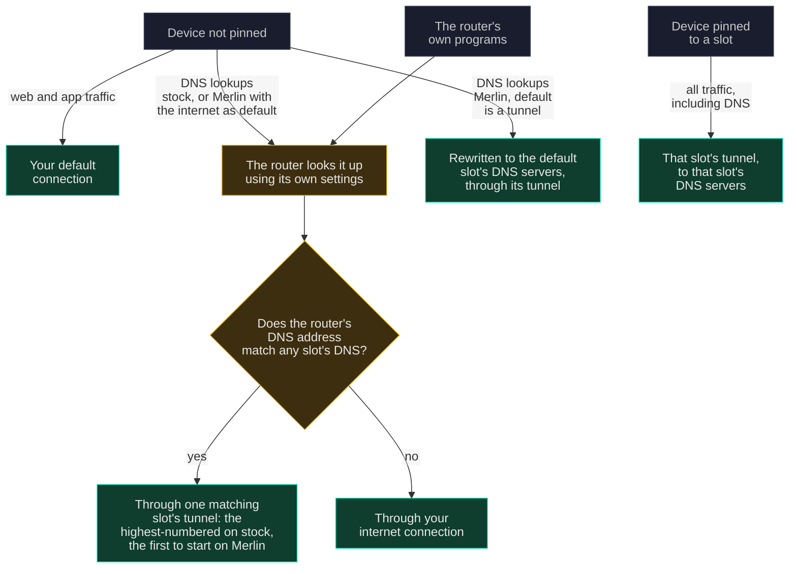
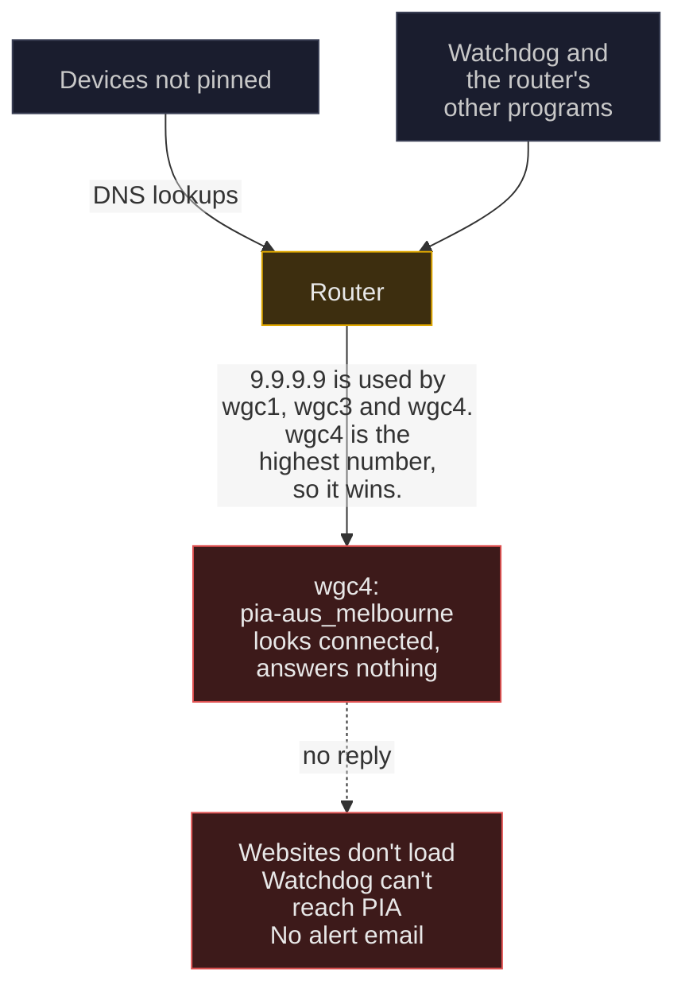
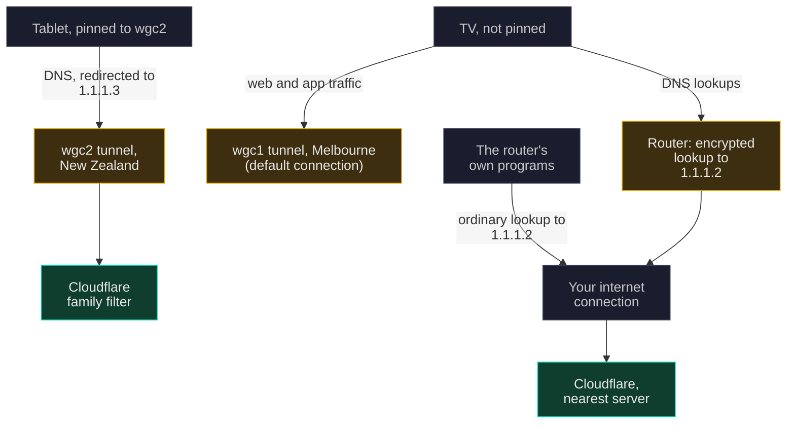
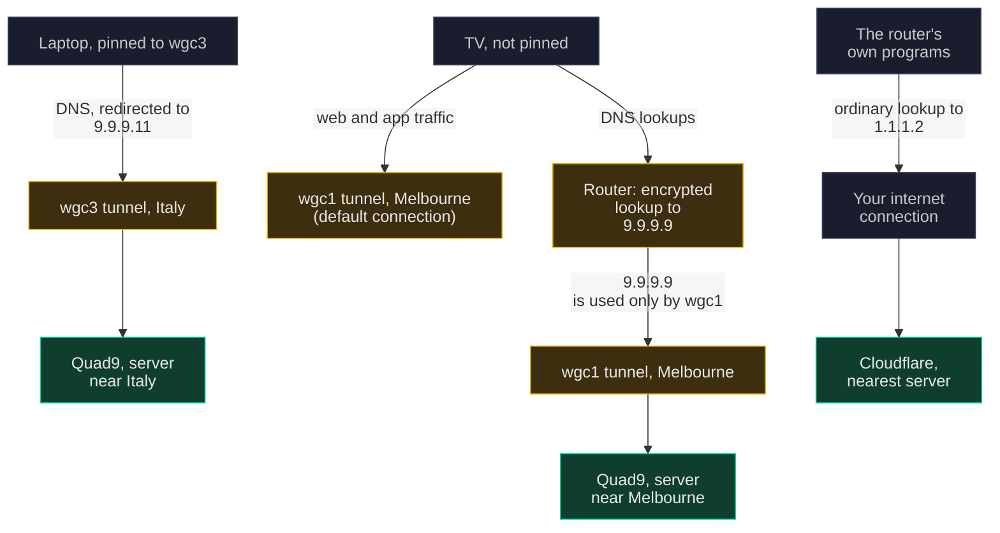
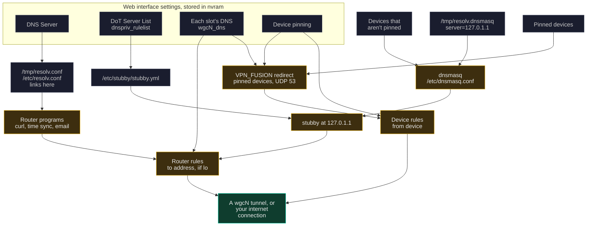

# DNS: where your lookups actually go

This is the long version. [README section 5.2.2](README.md#522-dns-where-your-lookups-go) has the short one, and links here for the detail.

> [!IMPORTANT]
> **On stock firmware, your default connection decides where a device's traffic goes. It does not decide where that device's DNS goes. On Asuswrt-Merlin it does, when your default connection is a tunnel.**

If you read nothing else in this section, read that. It's easy to think of DNS as just more traffic that follows the same path as everything else. On a stock ASUS router it usually doesn't, and that one difference explains most of the surprises below. Merlin handles DNS differently, so wherever the two firmwares differ, each section says what each does.

Short version:

- **Pin a device to a slot** and its DNS follows that slot, on both firmwares.
- **A device that isn't pinned** differs. On stock it uses the router's own DNS settings, whatever your default connection is. On Merlin, when your default connection is a tunnel, its lookups are sent to that slot's DNS servers through that tunnel; when the default is the internet, it uses the router's own settings, as on stock.
- **Keep the router's DNS addresses away from your slots' DNS addresses**, unless you choose to share one on purpose (setup B below). If a slot uses the same address as the router, one broken tunnel can stop the router's own lookups, and on stock every device that isn't pinned, from finding websites, and stop the watchdog from fixing it. On Merlin, a slot that is stopped can instead send the router's lookups out over your internet connection (section 4).

This section was written for stock ASUS firmware, and its rules and measurements are stock's (`VPN_FUSION`, and the slot numbering), measured in September 2026. Asuswrt-Merlin was measured on 388.13_0: first from build 575 (its `DNSVPN` chains, which rewrite a routed device's lookups to its slot's DNS servers), and again on 2026-11-20 (the default connection's DNS, slots sharing an address, and a stopped slot, each run on one router, with DNS-over-TLS and DNS Director on unless a section says otherwise). Where a statement below isn't marked, both firmwares behave the same; where it differs, both are described. ROUTER DNS ROUTING reads both firmwares, and the Merlin detail is in [ARCHITECTURE.md](ARCHITECTURE.md). Each Merlin measurement was taken once on one router, and ARCHITECTURE 6.10 lists every run and what it did and didn't show.

- [1. What is DNS?](#1-what-is-dns)
- [2. Why doesn't my DNS follow my default connection?](#2-why-doesnt-my-dns-follow-my-default-connection)
- [3. Who looks things up on the router?](#3-who-looks-things-up-on-the-router)
- [4. How can one tunnel take away DNS for everything?](#4-how-can-one-tunnel-take-away-dns-for-everything)
- [5. What should I set?](#5-what-should-i-set)
  - [5.1. Setup A: reliable](#51-setup-a-reliable)
  - [5.2. Setup B: private](#52-setup-b-private)
- [6. Using a slot for parental controls](#6-using-a-slot-for-parental-controls)
- [7. For the technically inquisitive](#7-for-the-technically-inquisitive)
  - [7.1. The pieces](#71-the-pieces)
  - [7.2. The router rules](#72-the-router-rules)
  - [7.3. Why a broken tunnel could blackhole DNS](#73-why-a-broken-tunnel-could-blackhole-dns)
  - [7.4. Pinned and not pinned devices](#74-pinned-and-not-pinned-devices)
  - [7.5. Common DNS services](#75-common-dns-services)
  - [7.6. See it on your router](#76-see-it-on-your-router)

### 1. <a name='what-is-dns'></a>What is DNS?

DNS is the internet's phone book. It turns a name like `example.com` into the address your device actually connects to. The server that answers is called a DNS server, or resolver.

### 2. <a name='why-doesnt-my-dns-follow-my-default-connection'></a>Why doesn't my DNS follow my default connection?

On stock firmware, because a device that isn't pinned doesn't send its lookups out to the internet. It sends them **to the router**, and the router makes the lookup for it.

Think of a hotel. Your default connection is the taxi you've booked: it takes you, your web and app traffic, wherever you're going. But when you ask the concierge for a restaurant's address, you don't get in the taxi. The concierge looks it up on the hotel's own phone, and your taxi booking has no say in how they do it.

A stock router works the same way. Your device's lookup arrives at the router and stops there. The router then makes a new lookup of its own, and the router's own rules decide which way that goes. Your default connection only applies to traffic that passes **through** the router to somewhere else, so it never sees the lookup.

**Merlin is different when your default connection is a tunnel.** Its firewall doesn't let the router make the lookup. It rewrites the lookup on its way in, to the default slot's DNS servers, and the lookup then leaves through that slot's tunnel, like the rest of the device's traffic: the concierge gets in the taxi. Measured on 388.13_0 on 2026-11-20 with the default connection on `wgc5`: the connection table showed a device's lookup, addressed to the router, answered by `wgc5`'s DNS server through `wgc5`'s tunnel address, and the rewrite rule's packet count rose while DNS Director's catch-all rule stayed at zero. When the default connection is the internet, Merlin forces a device's plain DNS to the router, as stock does (ARCHITECTURE 6.10, 2026-11-14, and measured again on 2026-11-20: the rewrite for the whole LAN went away, leaving only the pinned devices', and new lookups from unpinned devices were answered by the router itself). DNS Director makes no difference to a device that isn't pinned while the default is a tunnel: with it switched off, new lookups were still answered by the default slot's DNS server. With the default on the internet and DNS Director off, a device's plain DNS goes to whatever server it was given, which here was the router.

A device pinned to a slot is the same on both firmwares. The router catches its ordinary lookups and sends them to that slot's DNS servers, through that slot's tunnel.



<p align="center"><em>Where a device's lookups go: to the router if it isn't pinned (on Merlin, only when the default connection is the internet), through its slot's tunnel if it is.</em></p>

### 3. <a name='who-looks-things-up-on-the-router'></a>Who looks things up on the router?

Two groups, and they use different settings.

**Your devices** look up websites, apps, streaming services and everything else you use. On stock, devices that aren't pinned use the router's **DNS-over-TLS (DoT) Server List**. DoT is DNS sent inside an encrypted connection, so your internet provider can't read it. On Merlin that holds only when your default connection is the internet. When it's a tunnel, devices that aren't pinned use the default slot's DNS servers instead, through that tunnel (section 2), and the DoT Server List isn't used for them.

**The router itself** looks up names for its own work. On stock it uses the router's **DNS Server** setting. On Merlin its programs ask the router's own dnsmasq (their `/etc/resolv.conf` names `127.0.0.1`), which hands the lookup to stubby and so to the **DoT Server List** when DNS-over-TLS is on. With DoT on, the DNS Server setting is still written to `/tmp/resolv.conf` on Merlin, but nothing reads it. With DoT off, dnsmasq's list of servers becomes the DNS Server setting, and the router's own lookups go to those addresses as ordinary DNS (measured on 388.13_0 on 2026-11-20, once each way; the DoT-off run needed the WAN restarted for the router to rewrite that list). For example:

- setting its clock (time servers);
- checking for firmware updates;
- keeping a DDNS name up to date, and the ASUS app's remote access, if you use them;
- the cfg-pia-wg watchdog reaching PIA to rebuild a tunnel;
- the watchdog sending you an alert email; and
- on stock only, downloading the helper programs cfg-pia-wg installs. Merlin ships what the app needs, so it installs none.

Is the router's own lookup encrypted? On stock that's up to the program making it, not the router. Most programs on the router look names up using ordinary DNS, which isn't encrypted. On Merlin with DoT on, their lookups go through stubby, so they are encrypted on the way out; with DoT off they are ordinary DNS, to the DNS Server setting, and if that address is also a slot's DNS address they leave through that slot's tunnel. The watchdog doesn't depend on either: it looks up PIA's servers and your mail server over encrypted DNS (DoH), using the resolver chosen on the WATCHDOG form, Cloudflare unless you pick another. It sends each DNS query to that resolver itself, over HTTPS, and hands the answer to the program that needs it, so the name is never looked up in the clear. If the resolver doesn't answer, the watchdog looks the name up the ordinary way, so it can still rebuild your tunnel, and its log says so. Leave both of its DoH fields empty and it uses ordinary DNS like everything else, so your internet provider could see that the router looked up a PIA server name, but nothing more. Either way, everything the watchdog then sends and receives is encrypted (HTTPS).

Until build 477 that paragraph was not true. The watchdog asked the router's own `curl` to use DoH, and ASUS's `curl` ignores that request on both stock and Merlin firmware, without a word: found 2026-09-30, when a DoH server that didn't exist made no difference at all. Every lookup it called encrypted went out as ordinary DNS. No public release carried that build.

### 4. <a name='how-can-one-tunnel-take-away-dns-for-everything'></a>How can one tunnel take away DNS for everything?

Each VPN slot can have its own DNS servers. That's how you can send a child's tablet to a family filter while your own devices use something else.

There's a catch. When a slot has DNS servers set, the router also sends **its own** traffic to those addresses through that slot's tunnel, on both firmwares. If the router's DNS settings use the same address as a slot, the router's lookups travel down that slot's tunnel. If more than one slot uses that address, which slot carries them depends on the firmware:

- **On stock**, the highest-numbered slot carries them.
- **On Merlin**, the slot that started first carries them: `wgc1` after a boot, and it can change at any restart. A slot that starts later doesn't take them over, whatever its number (measured on 388.13_0 on 2026-11-20, once: with `wgc1` up, `wgc2` and then `wgc3` started sharing its addresses, and the route stayed with `wgc1`).

cfg-pia-wg can't change how the router routes its own traffic, and it never changes your router's DNS settings: they're yours.

Here's an example router with five slots:

| Slot | PIA region | Role | Slot DNS |
| --- | --- | --- | --- |
| `wgc1` | `pia-aus_melbourne` | Default connection, watchdog on | Quad9: `9.9.9.9`, `149.112.112.112` |
| `wgc2` | `pia-nz` | Child's tablet | Cloudflare family: `1.1.1.3` |
| `wgc3` | `pia-italy` | | Quad9: `9.9.9.9`, `149.112.112.112` |
| `wgc4` | `pia-aus_melbourne` | | Quad9: `9.9.9.9`, `149.112.112.112` |
| `wgc5` | `pia-uk` | | Cloudflare: `1.1.1.1`, `1.0.0.1` |

This router's DNS Server and DoT Server List are both set to Quad9, `9.9.9.9` and `149.112.112.112`. Three slots use the same addresses. On stock, `wgc4` is the highest-numbered, so the router's lookups go through `wgc4`. On Merlin they go through whichever of the three started first, `wgc1` after a boot. The rest of this section follows the stock example; the Merlin differences are marked.

For example, suppose `wgc4:pia-aus_melbourne` breaks because PIA has rotated that server's key, as it does from time to time. The tunnel still looks connected, but nothing comes back. This is what happens on stock:



<p align="center"><em>On stock, one broken slot that shares the router's DNS address takes every unpinned device's lookups with it.</em></p>

On Merlin the same break needs the broken slot to be the one that holds the address, `wgc1` in this example, and then:

- **The router's own lookups stop**, and so does the watchdog, as below.
- **Devices that aren't pinned lose DNS when the default connection is that slot**, because on Merlin their lookups go to the default slot's DNS servers (section 2). That is true of the default slot whether or not it shares an address with the router.

On stock:

- **Devices that aren't pinned can't find any website.**
- **The watchdog can't rebuild a tunnel.** It can't reach `serverlist.piaservers.net` (PIA's server list), `www.privateinternetaccess.com` (your login token) or `raw.githubusercontent.com` (PIA's security certificate).
- **No alert email is sent,** because the watchdog can't find your email server.
- **Pinned devices keep working,** because their DNS goes through their own slot.

The broken slot doesn't need to be your default connection, or have a watchdog, for this to happen. It only needs to use the same DNS address as the router. cfg-pia-wg can't change this router behaviour, but on both firmwares (Merlin since build 581) it tells you when a slot's DNS uses the same address as your router's DoT Server List: the note appears under the DNS field as you type it, in CREATE and in EDIT, and names the addresses that overlap.

What if the slot is stopped rather than broken? It differs again.

- **On stock**, the router drops that slot's rules and moves its lookups to the next-highest slot using the same address, here `wgc3` in Italy. Lookups keep working, but they're answered by a server near Italy.
- **On Merlin**, the route to the address is dropped and nothing takes it over. The router's lookups for that address leave over your **internet connection**, from your home address, until a slot that shares the address starts again; the first to start then holds it, whatever its number. If the lookups are the router's DoT ones they are still encrypted, but your provider can see where they go. A lookup the router sent to the address with the slot stopped left from the router's WAN address and was answered, in the connection table, where with the slot up it left from the tunnel's address (2026-11-20). Merlin's own source explains the rest: it adds a route for each of a slot's DNS addresses with `ip route add`, which fails when a route to that address exists, so the first slot to start keeps it, and stopping the slot deletes its interface and with it the route (`rc/wireguard.c` at tag 3004.388.13). Measured on 388.13_0 on 2026-11-20, once: with `wgc1` stopped, `wgc2` and `wgc3` were both running and the router's route to `9.9.9.9` went to the internet connection; when `wgc3` was restarted it took the route; when `wgc3` was stopped again and `wgc2`, the lower number, was restarted, `wgc2` took it. Restarting a slot that didn't hold the route, and starting `wgc1` last, took nothing.

On both firmwares only a slot that looks connected but answers nothing makes lookups disappear. On Merlin a slot with no handshake held the route in the same test, so the router's lookups were pointed into a tunnel that answers nothing (routing only: no lookup was sent).

### 5. <a name='what-should-i-set'></a>What should I set?

Start with the devices you care most about.

**Pin them.** A pinned device's DNS goes to its slot's DNS servers, through its slot's tunnel. Its lookups leave from the same place as its traffic, and nothing else on the router can move them. `cfg-pia-wg` makes pinning painless and easily visible in DEVICES, and you can set your default connection to the Internet or to any slot you choose.

Then set the router. Both settings are under **Advanced Settings > WAN > Internet Connection > WAN DNS Setting** (see the [screenshot in `README`](https://github.com/ExponentiallyDigital/cfg-pia-wg/blob/main/README.md#42-router-dns-settings)):

- **DNS Server** (click **Assign**). This is for the router's own lookups, and the watchdog's too if you turn its encrypted DNS off.
- **DNS-over-TLS (DoT) Server List.** This is for every device that isn't pinned. It appears when **DNS Privacy Protocol** is set to **DNS-over-TLS (DoT)**.

For the **DNS Server**, whichever setup you choose below, use addresses that no slot uses, from a service that blocks malware. The router makes few lookups of its own, but if anything on it ever misbehaves, a filtering service is one more thing in its way. Example: Cloudflare's malware filter, `1.1.1.2` and `1.0.0.2`.

For the **DoT Server List**, there are two sensible setups. Both work. Each costs something different, and the choice is yours. The table and the two setups below are stock's.

On Merlin the DoT Server List matters less than on stock. When your default connection is a tunnel, devices that aren't pinned use the **default slot's DNS servers** through that tunnel (section 2), so those servers are what decide who sees their lookups, and the default slot's tunnel is the one that must keep answering. The DoT Server List then serves the router's own lookups only. When the default connection is the internet, the setups apply to Merlin as they do to stock, with the two differences marked in the table.

| | Setup A: reliable | Setup B: private |
| --- | --- | --- |
| DoT Server List | Addresses **no slot** uses | The same addresses as **one** slot in your own country, with the watchdog on. No higher-numbered slot may use them. On Merlin no other slot may use them at all, because the first slot to start holds them, not the highest-numbered. |
| Lookups from devices that aren't pinned | Go straight out over your internet connection, encrypted, to the nearest server | Go through that slot's tunnel, encrypted |
| Who sees your home address | The DNS provider | Nobody: the provider sees PIA's address. On Merlin, while that slot is stopped, the router's own lookups for those addresses go out over your internet connection and the provider sees yours |
| If one tunnel breaks | Lookups carry on | If that slot looks connected but answers nothing, every device that isn't pinned loses DNS until the slot is rebuilt (on Merlin, only the router's own lookups, unless that slot is also the default connection) |
| What cfg-pia-wg says | Nothing: there is nothing to say | A note under the DNS field, naming the shared addresses. It's information, not a warning - you matched them on purpose |

#### 5.1. <a name='setup-a-reliable'></a>Setup A: reliable

| Setting | DNS servers |
| --- | --- |
| Router: DNS Server | `1.1.1.2`, `1.0.0.2` |
| Router: DoT Server List | `1.1.1.2` and `1.0.0.2`, port `853`, TLS hostname `security.cloudflare-dns.com` |
| `wgc1`, `wgc3`, `wgc4` | Quad9: `9.9.9.9`, `149.112.112.112` |
| `wgc2` | Cloudflare family: `1.1.1.3` |
| `wgc5` | Cloudflare: `1.1.1.1`, `1.0.0.1` |



<p align="center"><em>Setup A on stock: unpinned devices' lookups leave over your internet connection, encrypted, and no tunnel can take them down.</em></p>

Notice the TV. On stock its traffic leaves through `wgc1`, but its lookups leave through your internet connection, even though your default connection is a tunnel. They're encrypted, so your internet provider can't read them, but Cloudflare sees your home address. On Merlin, with `wgc1` as the default connection, the TV's lookups are sent to `wgc1`'s DNS servers (Quad9 here) through `wgc1`'s tunnel instead, so Cloudflare doesn't see your home address, and a broken `wgc1` stops the TV's lookups.

#### 5.2. <a name='setup-b-private'></a>Setup B: private

The DoT Server List uses the same addresses as `wgc1`, and every other slot uses different addresses. Quad9 offers a second set of addresses that does the same job, so the overseas slots and `wgc4` can use those. `wgc4` is in Melbourne too, but it has a higher number than `wgc1`, so it must not use the router's addresses.

| Setting | DNS servers |
| --- | --- |
| Router: DNS Server | `1.1.1.2`, `1.0.0.2` |
| Router: DoT Server List | `9.9.9.9` and `149.112.112.112`, port `853`, TLS hostname `dns.quad9.net` |
| `wgc1` (default connection, watchdog on) | Quad9: `9.9.9.9`, `149.112.112.112` |
| `wgc2` | Cloudflare family: `1.1.1.3` |
| `wgc3`, `wgc4` | Quad9: `9.9.9.11`, `149.112.112.11` |
| `wgc5` | Cloudflare: `1.1.1.1`, `1.0.0.1` |



<p align="center"><em>Setup B on stock: unpinned devices' lookups go through wgc1's tunnel, so the DNS provider sees PIA's address, not yours.</em></p>

On Merlin, setup B needs two things. The slot that carries the addresses must be the first to start (`wgc1` after a boot, but any restart can change it), and it mustn't be stopped while the router relies on it, because then the router's own lookups go out over your internet connection until a slot starts again. If that slot is also the default connection, its DNS servers are the ones devices that aren't pinned use too. ID-594 is the work item for choosing what carries the router's own DNS.

There's a bonus in using `9.9.9.11` on overseas slots. It passes part of the sender's address on to the website's own DNS servers, and for a device on `wgc3`, the sender is PIA's server in Italy. Websites then send that device to their servers near Italy, not near you. Your home address isn't passed on.

### 6. <a name='using-a-slot-for-parental-controls'></a>Using a slot for parental controls

This is a suggested approach, not advice. Your network and your family's setup are yours to decide.

This works the same on stock and on Merlin: a device pinned to a slot has its ordinary lookups sent to that slot's DNS servers on both (Merlin's `DNSVPN` chains, measured 2026-11-14), and the device-side steps below don't depend on the firmware. A filtering DNS service on a child's slot only works when the child's device asks the router for DNS in the ordinary way. A device that encrypts its own DNS, or sends it to another server, goes straight past the filter. On the child's device:

- **Android:** set **Settings > Network and internet > Private DNS** to **Off** or **Automatic**. Automatic is fine: the router doesn't offer encrypted DNS, so the device falls back to the ordinary way.
- **iPhone and iPad:** turn off **iCloud Private Relay** (**Settings > [your name] > iCloud > Private Relay**). Remove any DNS profile under **Settings > General > VPN & Device Management**. Under **Settings > Wi-Fi**, tap the (i) next to your network and check that **Configure DNS** is **Automatic**.
- **Browsers:** turn off **Use secure DNS** in Chrome and Edge, and **DNS over HTTPS** in Firefox.
- **Apps:** avoid ad blockers, VPN apps and other apps that set their own DNS.

>[!TIP]
> For an _**extensive**_ list of DNS providers, see [Adguard's KB](https://adguard-dns.io/kb/general/dns-providers).
> 
### 7. <a name='for-the-technically-inquisitive'></a>For the technically inquisitive

What follows is a representation of what a stock ASUS router can look like. Everything in it was measured on one stock ASUS router in September 2026, not read in documentation - ASUS publish none of it. Other models and firmware versions may differ. Merlin builds these differently (its own `DNSVPN` chains, a route in the main table for each slot's DNS servers, and `/etc/resolv.conf` pointing at its own dnsmasq): see sections 2 to 5 for what differs, and [ARCHITECTURE.md](ARCHITECTURE.md) 6.10 for the detail. The commands in 7.6 that name `VPN_FUSION` and the `iif lo` rules are stock's; on Merlin, `iptables -t nat -S | grep DNSVPN` shows its rewrites and `ip route show table main` its routes to each slot's DNS servers.

#### 7.1. <a name='the-pieces'></a>The pieces

- **dnsmasq** is the router's local DNS server. Devices send their lookups to it, at the router's LAN address, port 53.
- **stubby** is a small program that turns ordinary lookups into encrypted DoT. It listens on the router at `127.0.1.1`, port 53.
- **dnsmasq hands lookups to stubby.** With DoT on, `/tmp/resolv.dnsmasq` contains a single line, `server=127.0.1.1`, so dnsmasq forwards everything to stubby. Stubby then connects to the DoT Server List on port 853.
- **The router's own programs don't use dnsmasq.** They read `/etc/resolv.conf` and make ordinary lookups, as programs do on any Linux system.

**How the DNS Server setting reaches `/etc/resolv.conf`:** when you click **Apply**, or the internet connection comes up, the firmware rewrites `/tmp/resolv.conf` from the DNS Server setting. `/etc/resolv.conf` is a link to that file. With DoT on, the firmware also adds stubby (`nameserver 127.0.1.1`) as the last entry. The firmware also adds a route for each DNS Server address through your internet connection.

The settings you choose in the web interface are stored in nvram, the router's settings store. The firmware builds the files, rules and redirects from them:



<p align="center"><em>How the settings you choose become the files, programs and routing rules that carry a lookup.</em></p>

#### 7.2. <a name='the-router-rules'></a>The router rules

For each address in a slot's DNS, the firmware adds a routing rule. On the example router above, `ip rule show` includes:

```text
1016: from all to 1.1.1.1 iif lo lookup 5          # wgc5
1017: from all to 1.0.0.1 iif lo lookup 5          # wgc5
1019: from all to 9.9.9.9 iif lo lookup 6          # wgc4 WINS
1020: from all to 149.112.112.112 iif lo lookup 6  # wgc4 WINS
1022: from all to 9.9.9.9 iif lo lookup 7          # wgc3
1023: from all to 149.112.112.112 iif lo lookup 7  # wgc3
1025: from all to 1.1.1.3 iif lo lookup 8          # wgc2
1028: from all to 9.9.9.9 iif lo lookup 9          # wgc1
1029: from all to 149.112.112.112 iif lo lookup 9  # wgc1
```

Reading one rule, `1019: from all to 9.9.9.9 iif lo lookup 6`:

- **`1019`** is the rule's priority. The router checks rules from the lowest number up and uses the first that matches.
- **`from all`** matches any sender.
- **`to 9.9.9.9`** matches traffic going to that address.
- **`iif lo`** means "input interface: loopback". Loopback is the router talking to itself, so this matches only traffic the router creates, from its own programs and from stubby. Traffic from your devices arrives on the LAN interface instead, so these rules never match it.
- **`lookup 6`** means "route this using routing table 6".

Each slot has its own routing table:

| Slot | Table | Rule priorities |
| --- | --- | --- |
| `wgc1` | 9 | 1028, 1029 |
| `wgc2` | 8 | 1025 |
| `wgc3` | 7 | 1022, 1023 |
| `wgc4` | 6 | 1019, 1020 |
| `wgc5` | 5 | 1016, 1017 |

The higher the slot number, the lower the table number and rule priority. So when more than one slot is set to the same DNS address, the highest-numbered slot's rule matches first and carries the router's lookups. Tables 6 to 9 were measured. Table 5 for `wgc5` follows the same pattern but hasn't been confirmed.

#### 7.3. <a name='why-a-broken-tunnel-could-blackhole-dns'></a>Why a broken tunnel could blackhole DNS

Each slot's table sends traffic through that slot's `wgcN` interface. WireGuard has no way of knowing whether the other end is still answering, so a broken tunnel's interface stays up. Its rules and routes stay in place, and lookups go in and get nothing back. Ping to an IP address may still work, because the ping doesn't need DNS and may take a different path.

A tunnel that's **stopped** is different. When a slot is stopped, from the web interface, from cfg-pia-wg or by the watchdog during a rebuild, the firmware removes that slot's rules. On the test router, stopping `wgc4` removed rules 1019 and 1020, and the router's lookups to `9.9.9.9` moved to `wgc3`. If no slot uses the address, they use the main routing table and go out through your internet connection.

If the router's DNS Server setting uses the same address as a slot, you'll also see a second route for that address in each slot's table, through your internet connection with `metric 1`. The firmware adds it for the DNS Server setting. While the tunnel is up, the tunnel's route wins.

#### 7.4. <a name='pinned-and-not-pinned-devices'></a>Pinned and not pinned devices

| | Pinned to a slot | Not pinned |
| --- | --- | --- |
| Web and app traffic | Its slot's table, through a rule of its own (`100: from <device> lookup <table>`) | The default connection's rule (`10000: iif br0 lookup <table>`), or the main table if the default is the internet |
| Ordinary DNS to the router (UDP 53) | Redirected by `VPN_FUSION` to its slot's DNS servers, then routed like the rest of its traffic | Answered by dnsmasq, then stubby, then the router rules above |
| DNS over TCP port 53, DoT (853) or DoH (443) | Not redirected: follows its own traffic route | Not redirected: follows the default connection |
| DNS sent straight to another server, such as `8.8.8.8` | Not redirected: follows its own traffic route | Not redirected: follows the default connection |

The redirect only matches UDP port 53 sent to the router's own address. DoH looks like ordinary web traffic, so no router can redirect it by port.

One more thing about a pinned device's own route. The firmware copies a few routes through your internet connection into each slot's table: the router's own DNS servers, the tunnel's PIA server, and your internet provider's local network. Before build 480, a pinned device reached those addresses outside its tunnel, even with the tunnel up: a phone using Android's Private DNS at `1.1.1.2`, say, sent it from your real address. The app's fail-closed guard now holds each of those addresses to the tunnel, or blocks it while the tunnel is down.

#### 7.5. <a name='common-dns-services'></a>Common DNS services

Addresses are as published in September 2026. Check the provider's site before you rely on them.

| Service | Blocks | Ordinary DNS | DoT hostname | DoH URL |
| --- | --- | --- | --- | --- |
| Quad9 | Malware | `9.9.9.9`, `149.112.112.112` | `dns.quad9.net` | `https://dns.quad9.net/dns-query` |
| Quad9, with location hint | Malware | `9.9.9.11`, `149.112.112.11` | `dns11.quad9.net` | `https://dns11.quad9.net/dns-query` |
| Quad9, unfiltered | Nothing | `9.9.9.10`, `149.112.112.10` | `dns10.quad9.net` | `https://dns10.quad9.net/dns-query` |
| Cloudflare | Nothing | `1.1.1.1`, `1.0.0.1` | `one.one.one.one` | `https://cloudflare-dns.com/dns-query` |
| Cloudflare, security | Malware | `1.1.1.2`, `1.0.0.2` | `security.cloudflare-dns.com` | `https://security.cloudflare-dns.com/dns-query` |
| Cloudflare, family | Malware, adult content | `1.1.1.3`, `1.0.0.3` | `family.cloudflare-dns.com` | `https://family.cloudflare-dns.com/dns-query` |
| AdGuard DNS | Ads, trackers | `94.140.14.14`, `94.140.15.15` | `dns.adguard-dns.com` | `https://dns.adguard-dns.com/dns-query` |
| AdGuard DNS, family | Ads, trackers, adult content | `94.140.14.15`, `94.140.15.16` | `family.adguard-dns.com` | `https://family.adguard-dns.com/dns-query` |
| Control D, malware | Malware | `76.76.2.1`, `76.76.10.1` | `p1.freedns.controld.com` | `https://freedns.controld.com/p1` |
| Control D, family | Malware, adult content | `76.76.2.4`, `76.76.10.4` | `family.freedns.controld.com` | `https://freedns.controld.com/family` |
| Mullvad | Nothing | Not offered (see note) | `dns.mullvad.net` | `https://dns.mullvad.net/dns-query` |
| Mullvad, base | Ads, trackers, malware | Not offered (see note) | `base.dns.mullvad.net` | `https://base.dns.mullvad.net/dns-query` |
| Google | Nothing | `8.8.8.8`, `8.8.4.4` | `dns.google` | `https://dns.google/dns-query` |
| PIA | Nothing | `10.0.0.243`, `10.0.0.242` (inside a PIA tunnel only) | Not offered | Not offered |

Notes:

- **Slot DNS must offer ordinary DNS.** The router's redirect sends plain port 53 lookups, so a slot can't use Mullvad, and PIA's addresses only work on a slot whose tunnel is up.
- **Mullvad only answers encrypted lookups.** Use `194.242.2.2` (`dns.mullvad.net`) or `194.242.2.4` (`base.dns.mullvad.net`) in the router's DoT Server List, with the matching hostname.
- **Google** records more about lookups than the privacy-focused services. It's included for comparison.
- **Quad9's encrypted lookups need HTTP/2, and the router's `curl` on Merlin 388.13 (8.17.0) doesn't have it.** Every lookup through `https://dns.quad9.net/dns-query` (and `dns11.quad9.net`) returned HTTP 505 from that router on 2026-11-15, so Quad9 can't be a watchdog's encrypted DNS there, though it works as a slot's ordinary DNS and in the router's DoT list. SAVE & DEPLOY now makes one real lookup through the server you chose and refuses to deploy when it fails, saying why. Cloudflare, AdGuard and Control D answered 200 from the same router. Stock's curl is 7.84 and hasn't been tried.

#### 7.6. <a name='see-it-on-your-router'></a>See it on your router

All of these commands only read. They change nothing.

```sh
ls -l /etc/resolv.conf                           # a link to /tmp/resolv.conf
cat /etc/resolv.conf                             # router programs' DNS servers
cat /tmp/resolv.dnsmasq                          # where dnsmasq sends lookups
cat /etc/stubby/stubby.yml                       # stubby's DoT servers
nvram get dnspriv_rulelist                       # the DoT Server List
nvram show 2>/dev/null | grep -E '^wgc[0-9]_dns' # each slot's DNS servers
ip rule show                                     # all routing rules
ip route get 9.9.9.9                             # the route for one address
iptables -t nat -S VPN_FUSION                    # pinned devices' redirects
for t in 5 6 7 8 9; do echo "table $t:"; ip route show table $t; done
                                                 # each slot's routing table
```

If `ip route get` names a `wgc` interface for an address in your router's DNS Server or DoT Server List, that address is shared with a slot.

---
