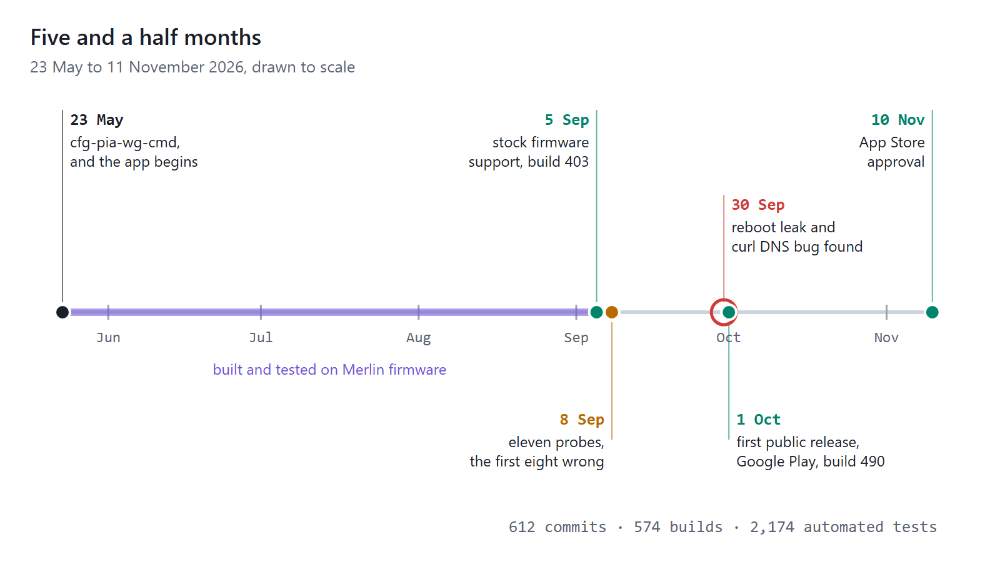
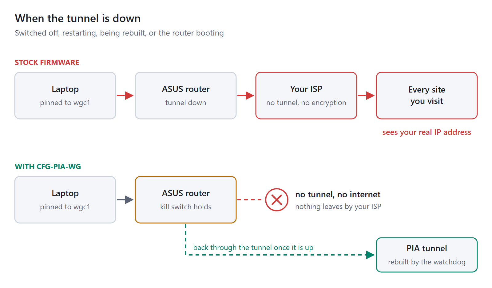
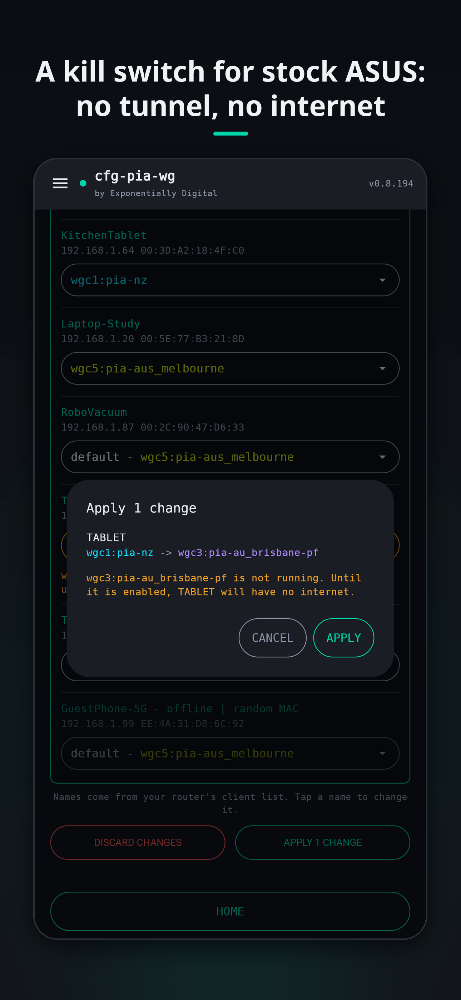
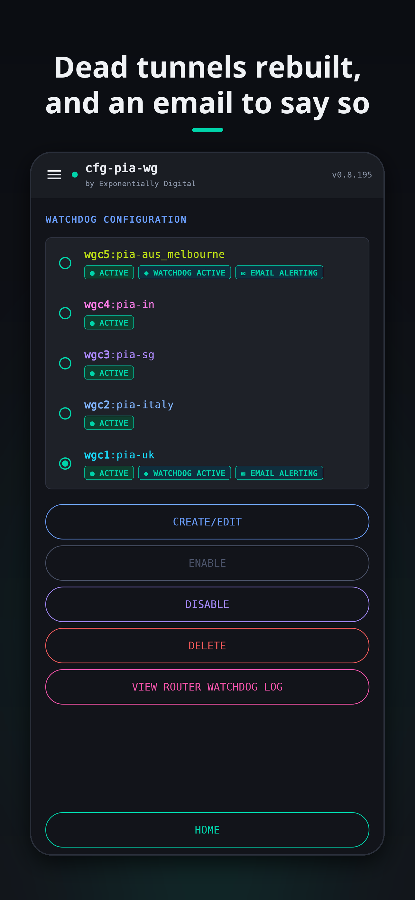
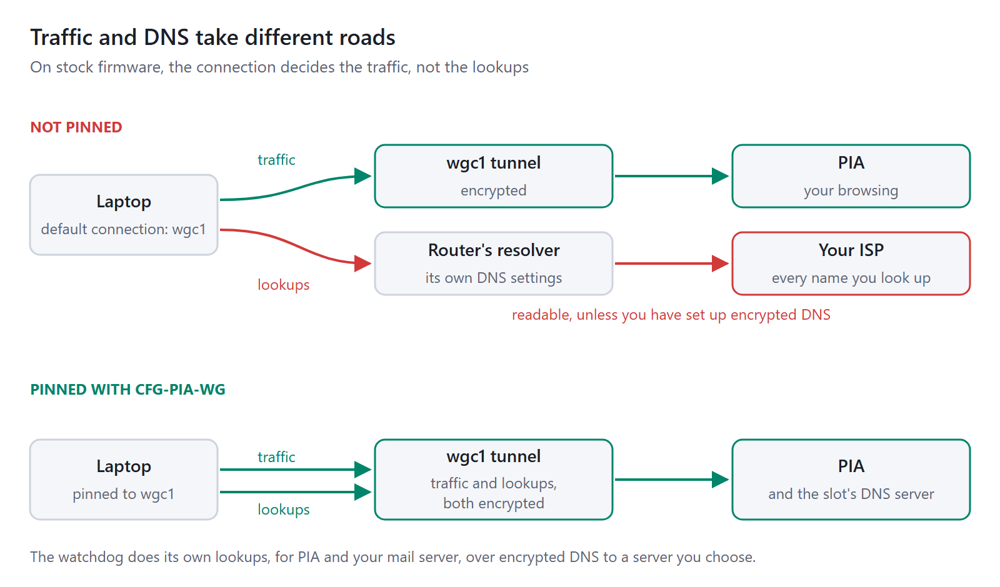
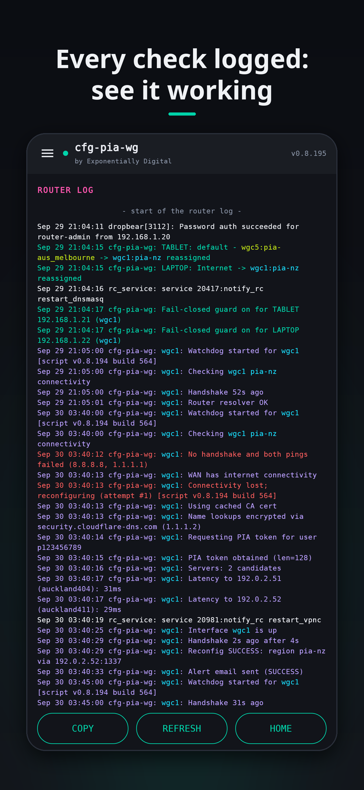
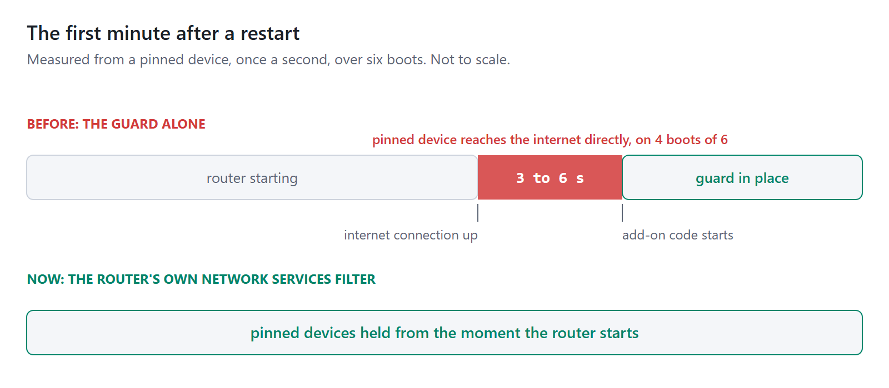
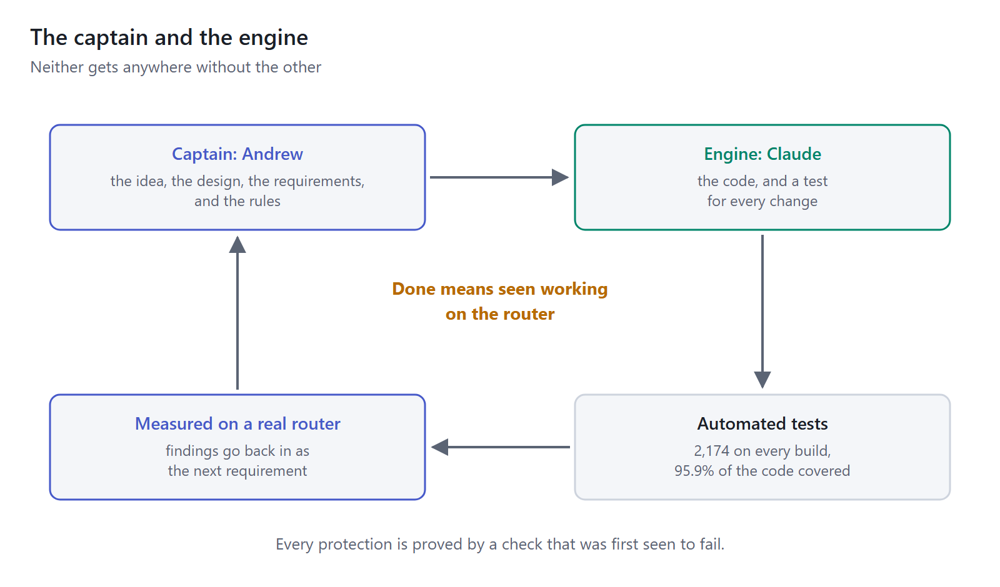
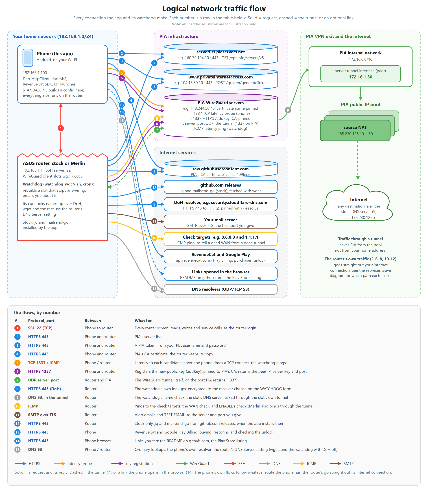

# Tunnel or nothing: the story of cfg-pia-wg

Yoast: focus keyphrase "WireGuard kill switch"; SEO title "WireGuard kill switch for ASUS routers: tunnel or nothing"; slug `tunnel-or-nothing-wireguard-kill-switch`; meta description "A PIA config tool became a WireGuard kill switch for stock ASUS routers: a watchdog, the DNS gap, and a reboot leak, measured and fixed." (136 characters, about 150 with the date Yoast adds).

Suggested categories: Development, Programming, Software, Thoughts. Featured image: `images/00-featured.png`. For WordPress, run `make_wordpress.py` and use `wordpress/`: upload `wordpress/images/`, then paste `wordpress/article.html` into the code editor.

---

*How a tool for making PIA configs became a WireGuard kill switch for ASUS routers, and what it took to prove it works.*

In May I wrote about [cfg-pia-wg-cmd](https://www.exponentiallydigital.com/five-times-faster-and-built-by-ai-the-story-of-pia-wireguard-cfg/), a small command-line tool that builds a fresh WireGuard configuration for Private Internet Access (PIA) in a minute or two. I finished by saying the config would be out of date in a week or two, and that this was, on balance, an excellent trade.

I still think it's an excellent trade. What I got wrong was how much of it I'd be happy to keep doing by hand.

This is the story of what came next: an Android and iOS app that grew, over five and a half months, 612 commits and 574 builds, from "make me a config on my phone" into something that runs on the router itself and keeps a promise I now care about more than speed. A device pinned to a VPN gets its tunnel, or nothing.

## The failure you can see, and the one a WireGuard kill switch stops

When a PIA WireGuard config expires, the tunnel stops passing traffic and everything using it stops with it. In May I called that no Internet at all. It's annoying. It's also the good failure, because you notice it.

The bad failure is quieter. Stock ASUS firmware sends a device through its tunnel only while that tunnel is up. Switch the tunnel off, restart it, rebuild it with a fresh config, or simply reboot the router, and for that time the device goes straight out through your ISP, showing your real IP address to every site it reaches. Nothing breaks. Nothing tells you. The pages keep loading.

Asuswrt-Merlin, the excellent community firmware, has a kill switch for exactly this. Stock firmware has no WireGuard kill switch at all.

What does success look like for a WireGuard kill switch? I wrote it down before any code, and it hasn't changed since: a device pinned to a tunnel gets that tunnel or no internet, through config expiry, a rebuild, the tunnel being switched off, and a restart.

Tunnel or nothing.

## From the command line to a WireGuard kill switch

The command-line tool solved the regeneration. It didn't solve the remembering. A config that expires "in a week or two" expires, in practice, at two in the morning on a Sunday, and the first anyone knows of it is when the television stops working.

So each part of the app moves a little more of the work away from me:

1. Generate a config on my phone, no laptop needed: the command-line tool's job, with a screen.
2. Write it straight into one of the router's five WireGuard slots, over SSH, from the phone.
3. Put a watchdog on the router itself, so a dead tunnel is rebuilt while I'm asleep, and an email tells me in the morning what happened.

The third changed the shape of the whole project. Once the watchdog runs on the router, the phone is just the remote. The protection covers every device on the network, including the ones that will never run a VPN app: the TV, the games console, the robot vacuum. And it keeps working with my phone switched off.

## The watchdog behind the WireGuard kill switch

Every few minutes, as often as you choose, the watchdog asks one question: is the tunnel actually passing traffic? Not "is it up", which a dead WireGuard tunnel will cheerfully claim, but does a ping get through it.

If it does, the watchdog logs it and goes back to sleep. If it doesn't, it builds a new tunnel from scratch, checking the signature on PIA's server list the same way PIA's own desktop app does, and the WireGuard kill switch holds the pinned devices offline while it works.

The email is the part I like most. Not "tunnel restarted", but how long it was down, whether the kill switch held while it was, which server it reconnected to and how quickly. When it can't reconnect, it says what to try and includes the tail of the router's own log. An alert worth reading, rather than one worth filtering.

## DNS, the half nobody watches

This is the part that surprised me most, and I suspect it surprises most people running a VPN on a router.

On stock firmware, the connection a device uses decides where its traffic goes. It does not decide where its DNS goes. A device can send every byte of its browsing through an encrypted tunnel while its lookups, a list of every name it asks for, go to the router, which answers using its own DNS settings, out through your ISP. Readable, unless you've set up encrypted DNS yourself.

Pinning fixes that: a pinned device's lookups follow its tunnel, so its traffic and its DNS leave from the same place. The watchdog's own lookups, for PIA's servers and your mail server, go over encrypted DNS to a server you choose.

The bigger fix was making it visible. ROUTER DNS ROUTING shows every path a lookup can take, yours, the router's and each watchdog's, each tagged with whether it goes through a tunnel or straight out, and whether anyone along the way can read it. The router's own web interface shows none of this.

## Measure, don't guess

There's an old Russian proverb, made famous in English by Ronald Reagan during the arms-control talks of the 1980s: trust, but verify. On a router, I've learnt to skip the first half.

Three stories from September make the case better than I can.

**Eleven probes.** Changing a router's default connection looks like setting one value. It isn't. It took eleven probes on real hardware to find a sequence that works, and the first eight were hypotheses. Each sounded reasonable. Each was wrong. What found it in the end was watching the router instead of reasoning about it: five steps, in one exact order, every one of them load-bearing.

**Two weeks of passing tests.** The watchdog was built to do its lookups over encrypted DNS, and for two weeks every test passed. The router's own `curl` was quietly ignoring its encrypted-DNS option the whole time. A download over ordinary DNS succeeds exactly like one over encrypted DNS, so a test that only checks that things work proves nothing about a protection. It's one reason every protection in the project is now proved by a check that has first been seen to fail.

**The reboot.** I'd proved the kill switch survived a restart. Or I thought I had: two log entries a second apart said so. So I watched it properly, from a pinned device, fetching a page by IP address once a second while the router rebooted, and recording which public address answered. On four boots out of six, the pinned device reached the internet directly, for three to six seconds, about a minute in. Stock firmware runs no add-on code until after the internet connection is up, so no guard I wrote could ever start in time.

The fix was to stop relying on my own code to start first. The router's own Network Services Filter is applied before its internet connection comes up, so the app now lists each pinned device there too. The WireGuard kill switch now holds from the moment the router starts, and the same test, from the same device, now passes.

I'd much rather have found that than not. It's exactly the kind of gap a happy-path test never shows.

## The captain and the engine

In May I wrote that I didn't write the code for cfg-pia-wg-cmd. GitHub Copilot did, and I designed every aspect of it. This time the engine was Claude, and the split is the same, only bigger.

I was the captain and Claude was the engine. Neither gets anywhere without the other. The ideas, the design and the requirements are mine. So are the rules it worked to:

- every change comes with a test;
- nothing is done until I've seen it working on my router; and
- every claim about protection is proved by a check that was first seen to fail.

Claude turned that into code far faster than I could type it. I measured, tested and decided; it built, and rebuilt, until the router agreed.

The rules matter more than the engine. An engine without a captain goes very fast in a very confident straight line, and a router is not a straight line. Eight wrong guesses in a row is what that looks like.

## Open, and checkable

Everything is on [GitHub](https://github.com/ExponentiallyDigital/cfg-pia-wg), so none of this needs to be taken on trust. Verified, on the other hand, you're most welcome to.

| What | As at 11 November 2026 |
| --- | --- |
| Code | 26,600 lines of app, 35,700 lines of tests |
| Automated tests | 2,174 on every build, covering 95.9% of the code |
| Manual tests | 179, 175 of them on a real router |
| SonarCloud | A for security, reliability and maintainability; 0 bugs, 0 vulnerabilities |
| Design | ARCHITECTURE.md: over 30,000 words and 14 flow diagrams |
| History | 612 commits and 574 builds since 23 May 2026 |

Every release is built, signed and uploaded to both stores by GitHub Actions from a tagged commit, after the tests and three security scanners have run, with every action pinned to an exact commit and a software bill of materials attached. The watchdog on your router is plain shell with its comments left in, generated from a template you can read in the repository. Every file the app writes is marked as its own, and anything it replaces is kept and put back on uninstall.

And every connection the app and the watchdog make is in one diagram, numbered, with what each is for and the path it takes: your home network, the tunnel, or straight out.

## What a WireGuard kill switch costs

The WireGuard kill switch, the watchdog and everything else cost nothing if you build it yourself. It's GPLv3, building it gives you everything unlocked, and [BUILDING.md](https://github.com/ExponentiallyDigital/cfg-pia-wg/blob/main/BUILDING.md) walks you through it.

If you'd rather not, it's on [Google Play](https://play.google.com/store/apps/details?id=com.exponentiallydigital.pia_wireguard_cfga) and the [App Store](https://apps.apple.com/app/cfg-pia-wg/id6824823717). Reading your router is free; writing to it is a one-time unlock, US$6.99 on Play and US$9.99 on iOS, where Apple's annual developer fee makes the difference. Same code either way.

You'll need an ASUS router on stock firmware 3.0.0.4.388 or later (Merlin works too, tested on 388.11 and 388.12; DEVICES on Merlin is coming in the next release), SSH turned on, and a PIA subscription.

## An excellent trade, revisited

In May I called WireGuard's expiring configs an excellent trade: five times the speed, for a minute or two of regeneration every week or two. Six months on, I'd make the same trade again. The difference is that I no longer make it by hand, and that while it's being made, at two in the morning on a Sunday, nothing on my network goes anywhere it shouldn't.

Tunnel or nothing.

---

cfg-pia-wg is on GitHub at [github.com/ExponentiallyDigital/cfg-pia-wg](https://github.com/ExponentiallyDigital/cfg-pia-wg), and its command-line ancestor at [github.com/ExponentiallyDigital/cfg-pia-wg-cmd](https://github.com/ExponentiallyDigital/cfg-pia-wg-cmd). Bugs and feature requests are welcome as [GitHub issues](https://github.com/ExponentiallyDigital/cfg-pia-wg/issues).

cfg-pia-wg is independent, and not affiliated with or endorsed by Private Internet Access, ASUS or WireGuard.

*How this was written: drafted with Claude from the project's own records, its changelog, test sheet and architecture notes, then edited by me. The diagrams were drawn the same way, in the app's own colours.*
